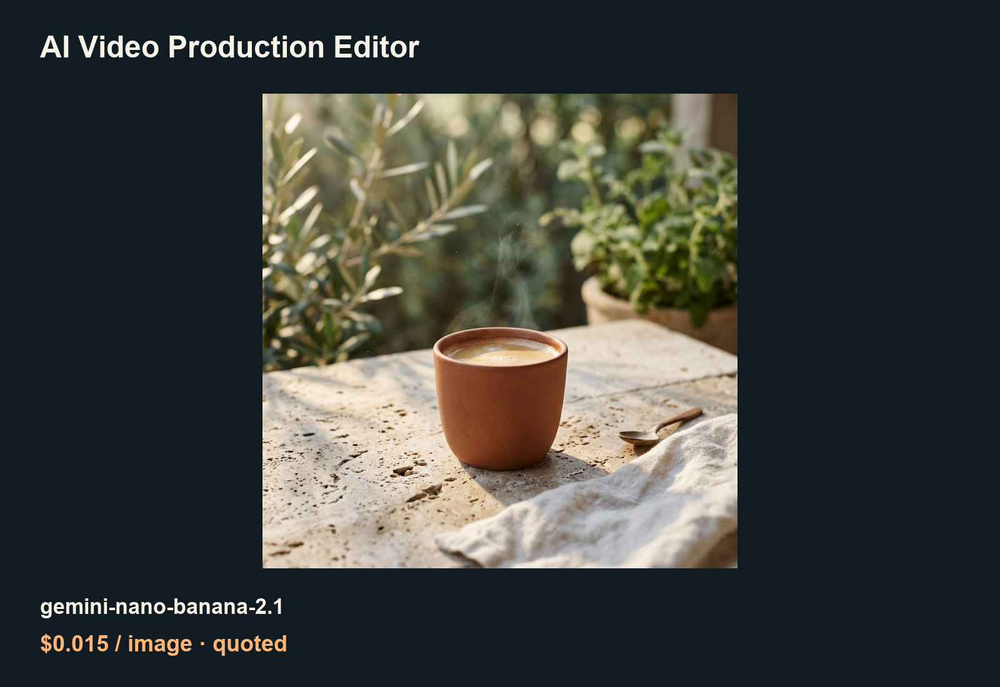

# Lower-cost media API guide for AI Video Production Editor

[English](README.md) · [中文](README_zh-CN.md)

A local film workstation: script, storyboard, shots, edit and export.

An independently maintained ToAPIs community guide, not an endorsed app edition. [Original project](https://github.com/LudwigKienle/ai-video-production-editor); [pinned source 6e916628](https://github.com/LudwigKienle/ai-video-production-editor/tree/6e91662888f4c99fa3b91279a62e572e2f8012d8).

## Examples



[MP4 demo](assets/kling-v3-9edf6511fb.mp4) · [Video parameters and settled charge](PRICING.md)

## Case prices (2026-10-21)

| Model / settings | Rate | Case fee / source |
|---|---:|---|
| gemini-nano-banana-2.1 · 1K | $0.015/image | Final image charge unavailable; same-key quote |
| kling-v3 · std / audio=false / requested 5s | $0.059524/s in this case | $0.3 settled; 5.04s file |

[Model landing page and current price](https://x.toapis.com/1021_av_gh) · [PRICING.md](PRICING.md)

## Validation scope

Real independent image/video API results, decoded video and import-oriented recipe. The original app Settings, router, task center and timeline were not modified or accepted.

## Generate and reuse

Use Python 3 and a private local `TOAPIS_API_KEY`; origin `https://toapis.com` without `/v1`. Query the price first; add `--live` explicitly to submit. Every run matches `/v1/pricing` for the same key and reads confirmed billing from submit/task responses.

```bash
python unified_client.py --model gemini-nano-banana-2.1 --prompt-file prompts/image.txt
python unified_client.py --model gemini-nano-banana-2.1 --prompt-file prompts/image.txt --max-usd 0.10 --run-id coffee-001 --live
```

The same inputs and run ID resume the original saved task. An uncertain submit stops rather than retrying. A new run ID is a new paid job.

[Project-specific integration](INTEGRATION.md) · [Sanitized case data](cases.json) · [Original prompts](prompts/)
